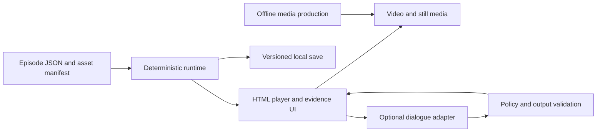

# Technical architecture — draft

## Decision
HTML + pre-rendered cinematic assets. Browser player with TypeScript or plain modern JavaScript (choose in Phase 1, justify dependencies); deterministic runtime. No 3D requirement. Start with an offline local static app and mock assets. A server is only introduced for optional provider calls, not basic gameplay.

## Proposed components
- `src/core/`: episode load, validate, immutable state transitions; current `src/engine.mjs` is the reference starter, migrate only with tests.
- `src/player/`: media lifecycle, subtitles, controls, loading/retry and choice overlay.
- `src/storage/`: versioned local saves, schema validation, corrupt save recovery, explicit reset. Never place provider secrets in browser storage.
- `episodes/`: data-driven episode/scene graph, evidence, asset manifests. Story IDs stable across releases; migrations explicit.
- `providers/` (later): mock dialogue first; server-side LLM adapter; local OmniVoice adapter; offline local Qwen ComfyUI adapter and direct Metaso/OSS video adapter. Real API contracts discovered from installed tools/configs or official docs only.

## State and authority
Runtime alone applies authored effects. Scene ID, evidence set, bounded trust, choice history. Each choice has explicit target, guard and effects. Invalid or unavailable choices fail without mutating the input. Every playable scene needs a route to an ending. No model can write arbitrary state or invent canon. Save envelope includes episode ID and version; unsupported versions fail gracefully. Baseline engine does not yet implement disk/browser persistence.

## Media UX
Playback must handle autoplay restrictions, mobile inline video, captions, buffering, missing assets, aspect ratio and accessibility. Provide play/pause, replay, subtitles, readable focus/keyboard controls. Preload next likely clip sparingly; do not preload an entire episode. Keep choices outside the video render; branch decisions work without a video provider.

## LLM (optional, Phase 3)
Inputs: actor ID, allowed canon facts, known evidence, conversation context and allowed topics. Output is untrusted `{utterance, intent, referencedFactIds}`; validate intent and fact IDs, reject/replace unsafe or invalid output, cap turns, use authored fallbacks. Do not forward user secrets or unnecessary private text. The output cannot unlock story branches except through separately authored validated actions. DeepSeek API is the preferred live provider; the exact model ID and endpoint require verification and owner approval. Mock is the default; offline tests are mandatory. See docs/06_DEEPSEEK_INTEGRATION.md. Provider endpoints and credentials stay server-side.

## Target environment (reported by owner, not verified)
Apple M5 Pro, 48 GB unified memory, about 400 GB free at prior report. ComfyUI is reserved for local Qwen-Image-2.1; H3 uses direct Metaso HTTP and Aliyun OSS; OmniVoice planned locally. Audit actual installation, storage and availability before integration. No download or invocation in Phase 0. A local browser demo must work if all optional providers are unavailable.

## Offline creative production handoff
Codex ImageGen (verified tool and shared-repo handoff) -> approved references/keyframes -> Aliyun OSS signed references -> direct Metaso MiniMax-H3 HTTP video -> reviewed assets -> manifest -> player. agy handles local imports and assembly; Codex prepares visual direction and shot prompts; movie generation stays with Metaso. See `docs/05_VISUAL_PRODUCTION.md`.

## Development worker
agy remains lead. Optional DeepSeek Harness supports isolated bounded development tasks only after separate owner approval; it is distinct from runtime DeepSeek API.

The offline video adapter must use the owner-selected Metaso MiniMax-H3 compatible endpoint, directly via HTTP; never through ComfyUI. This is a production-time service only; no browser or gameplay API calls. See `docs/07_METASO_VIDEO.md`.

See `docs/10_MEDIA_CAPABILITY_GATE.md` for the mandatory v0.3.0 production gates.

## Voice-first native AV requirement
Follow docs/12_VOICE_AND_NATIVE_AV.md: OmniVoice approved voice references precede speaking video; agy stages approved images and audio via private OSS and uses direct Metaso native reference-to-video with native audio. Preserve original dialogue audio. DeepSeek Harness checks streams and transcript; Codex reviews timbre, acting and lip sync. No forced post-dub or assumed exact voice reproduction. Runtime NPC TTS remains separate. Real capabilities require approved pilot evidence.

## Suno BGM requirement
Follow `docs/13_SUNO_BGM.md`, `contracts/music-provider.example.json` and `docs/00_PRODUCTION_BASELINE.md`. agy controls official Suno MCP and budgets (owner sign-in, no API key needed), Codex directs original instrumental cues and listening review, DeepSeek Harness prepares and checks local audio. REST access disabled and unverified; no unofficial API. Suno music remains a separate local track, ducked under H3 native dialogue; no music generation at runtime. Phase 0 offline only; Phase 2 authorization required for credits/downloads. Manual Suno import if verified MCP unavailable. No silent paid fallback.
