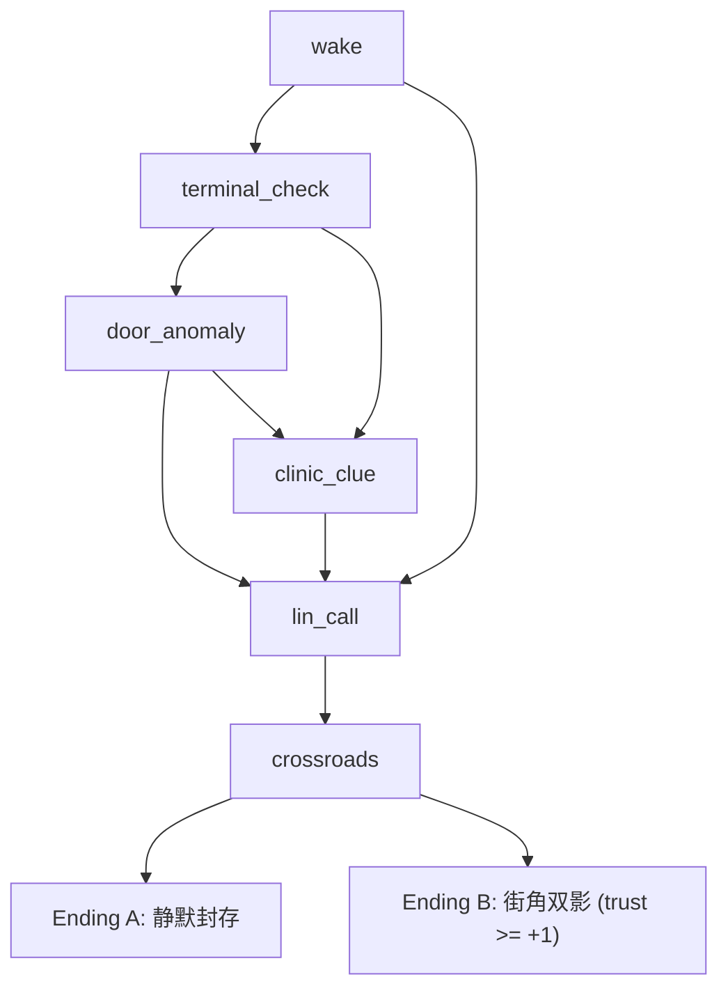

# Episode 01 Vertical Slice Narrative Design (Phase 1 Draft)

> Status: Phase 1 playable offline draft (awaiting owner narrative review before locking for Phase 2 visual/voice/video production).

## Scope & Pacing
- **Target duration**: 3–5 minutes per playthrough (6–7 scenes visited, 14–18 subtitle beats, 3–4 meaningful choices).
- **Locations**: Single primary apartment set (bedroom, living room desk, entryway) + exterior corner cliffhanger (placeholder still).
- **Characters**: Player (semi-defined POV), Lin (close contact, emotionally credible, not automatically hostile), System/Terminal cues, and the unseen Duplicate.
- **Originality**: Fully original near-future mystery grounded in `docs/02_WORLD_AND_STORY.md`; avoids binary "AI bad / human good" framing.

## Evidence Matrix
| Evidence ID | Label | Source | Reliability | Narrative Role |
|---|---|---|---|---|
| `death_notice` | 公民死亡注销通知 | 市政身份终端推送 | `verified` | Establishes the 72-hour legal death anomaly; unlocks `seal_evidence_here`. |
| `smart_lock_log` | 门锁生物识别记录 | 公寓门锁本地日志 | `contradictory` | Proves a biometric exit at 22:18 with no return entry. |
| `clinic_receipt` | 第七连续性诊所回执 | 桌面折叠终端加密缓存 | `unverified` | Introduces the institutional continuity experiment; unlocks `press_clinic_name` in `lin_call`. |
| `lin_voice_memo` | 林的矛盾证词 | 本地通话摘要 | `contradictory` | Confirms the duplicate met Lin 10 minutes earlier wearing the same clothes. |

## Branching & Replay Structure

- **Replay motivation**: Investigating first reveals `clinic_receipt` and unlocks a high-trust interrogation of Lin; calling Lin first builds immediate trust but leaves the player blind to the clinic receipt. Both endings raise the central mystery without resolving canon prematurely.
